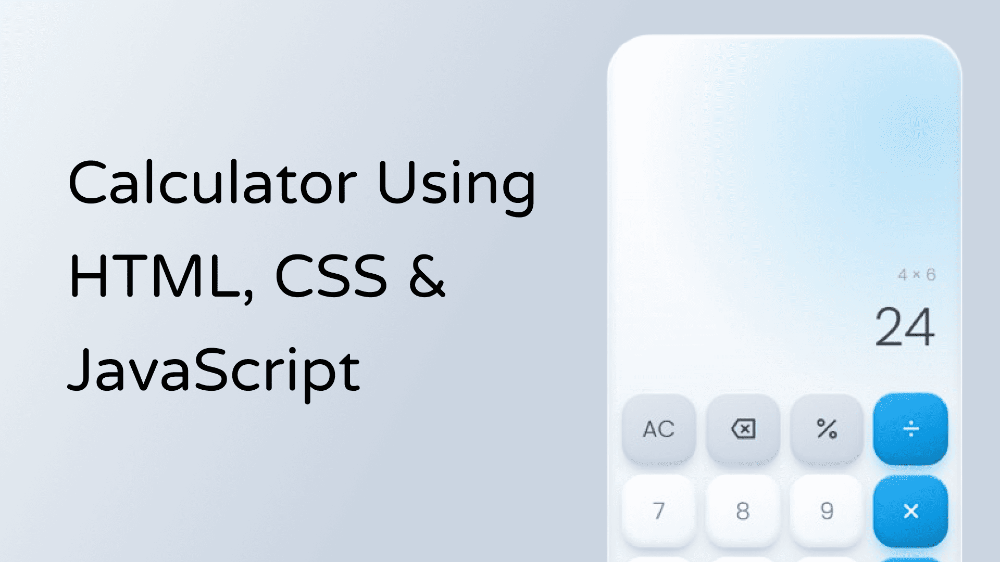

# Calculator

A simple, responsive calculator built with plain HTML, CSS and vanilla JavaScript. Soft neumorphic light design with a `#0b9eec` brand accent.



## Features

- Digits `0-9` and decimal point
- Operators: `+`, `-`, `*`, `/`
- `=` equals, `AC` all clear, `DEL` delete last digit, `%` percent
- Readonly display with a running expression line and thousand separators
- Chained operations (`5 + 3 x` shows `8` first)
- Floating-point cleanup (`0.1 + 0.2 = 0.3`)
- Division by zero shows an error and recovers on the next input
- Full keyboard support

## Project structure

```
01-Calculator/
├── index.html
├── assets/
│   ├── css/
│   │   └── global.css
│   └── js/
│       └── main.js
└── README.md
```

## Getting started

No build step or dependencies. Open `index.html` in a browser, or serve the folder:

```bash
cd 01-Calculator && bun ./index.html
```

## Keyboard shortcuts

| Key               | Action            |
| ----------------- | ----------------- |
| `0-9`             | Enter digit       |
| `.` or `,`        | Decimal point     |
| `+` `-` `*` `/`   | Operators         |
| `Enter` or `=`    | Calculate         |
| `Backspace`       | Delete last digit |
| `Esc` or `Delete` | All clear         |
| `%`               | Percent           |

## Tech

- HTML5, plain CSS (custom properties, grid)
- Vanilla JavaScript (no libraries)
- [Poppins](https://fonts.google.com/specimen/Poppins) via Google Fonts
- [Remix Icon](https://remixicon.com) 4.9.0 via jsDelivr CDN
- Colors: brand `#0b9eec` plus Tailwind slate palette values

## Customizing

Colors and fonts live in the `:root` variables at the top of `assets/css/global.css`. Change `--primary` to re-theme the calculator.

## Logic notes

- State: `current`, `previous`, `operator`, `overwrite`
- `%` divides the current value by 100
- Results are rounded to 12 significant digits to avoid float noise
- Input is capped at 15 digits
